# TradeSimple Intel



**A research workspace for the place where Washington meets the market.**

Explore congressional trades, federal contracts, lobbying, and insider filings. Ask questions, test ideas against historical data, and keep the evidence behind your conclusions in one place.

[**Try the demo**](https://jhsiehm.github.io/Tradesimple-intel/) · [What you can do](#what-you-can-do) · [Run it yourself](#run-it-yourself) · [Documentation](#documentation)

## Who it's for

- **Policy and political-risk analysts** connecting legislation, contracts, and lobbying to companies.
- **Journalists and researchers** investigating public disclosures and federal spending with sources they can inspect.
- **Investors and students** testing whether political signals carry information, with the assumptions and limitations visible.

## From a question to the evidence

A disclosed trade is a starting point. TradeSimple Intel helps you explore its context, test a hypothesis, and record what the evidence supports.

- **See the source and its age.** Panels identify their data sources, retrieval times, and reporting delays. A newly published filing can describe an older transaction; delayed quotes and dated snapshots are labeled.
- **Test with public-availability timing.** Backtests enter after a signal's recorded or assumed public date, rather than its transaction date. Timing assumptions, duplicate disclosures, missing prices, and other limitations are documented alongside results.
- **Reproduce a saved calculation.** Frozen runs retain their inputs and calculation engine. Export a run and replay it offline with `node replay.mjs`. Reproducing a result confirms the calculation, not its predictive value.
- **Inspect AI answers.** Research answers include source references, a record of lookups, and a check for unsupported references and numbers. The check can flag problems; it cannot guarantee an answer is correct.

## What you can do

### Research a question

Start with a plain-language question about the app's feeds, or choose to include the open web. Follow citations back to the supporting data and carry the conversation into the relevant board.

Questions to explore:

> Which members disclosed purchases of defense stocks?
>
> Backtest disclosed buys by House Energy and Commerce members, held for 60 days, against the S&P 500.
>
> What federal contract obligations does the app show for Lockheed Martin this fiscal year?

Available answers depend on configured sources and their coverage. Research answers require an AI provider; the guided experiment workflow does not.

### Follow congressional disclosures

**Today** presents recent filings in plain sentences, with links to source documents. Explore late filings, large disclosed trades, and frequently traded tickers, then open a member's timeline or a company's chart.

Leaderboards compare disclosed buys with the S&P 500. These are estimates based on disclosed transactions, not members' actual portfolio returns.

### Test and record an idea

**Backtest** evaluates congressional trades, insider transactions, contract awards, or lobbying signals against a benchmark. Choose your rules and inspect the return curve, trade list, formulas, and caveats.

**Research** lets you save experiments, import transaction data, and export frozen runs. In **Convergence Lab**, compare multiple sources under a locked plan with a separate holdout evaluation. Use versioned **Notebooks** to record hypotheses, conclusions, and the exact runs supporting them.

### Explore the wider context

| Area | What you can explore |
| --- | --- |
| **Congress** | Votes, bills, members, committees, and disclosed trades |
| **Markets** | US and global markets, insider transactions, fund holdings, and company supply chains |
| **Contracts** | Federal obligations by company, agency, district, or member geography |
| **Map and Districts** | Relationships among members, companies, filings, and locations; clearly labeled theories you add yourself |
| **News and Calendar** | Headlines, earnings, economic releases, and filing deadlines |
| **World monitoring** | Ships, aircraft, satellite imagery, point forecasts, and hazard reports, subject to source availability |

## Where the data comes from

Sources include House and Senate financial disclosures, SEC EDGAR, USAspending.gov, Congress.gov, the Lobbying Disclosure Act database, the FEC, FINRA, market-data providers, and publisher news feeds.

Coverage and freshness vary by source. Historical relationships, public-availability dates, and imported data can involve assumptions. The [source and freshness table](docs/REFERENCE.md#data-sources-and-freshness) and [backtest methodology](docs/REFERENCE.md#backtest-replay-public-records-against-a-benchmark) explain those limits.

## Try the demo

Open the [public demo](https://jhsiehm.github.io/Tradesimple-intel/) with no installation or keys. It runs from a **dated snapshot**, with a visible demo date and source timestamps. AI answers are unavailable, and data outside the snapshot is marked unavailable. Run the app locally to use connected feeds and the full research workflow.

## Run it yourself

Requires **Node.js 22.13 or later**.

```bash
git clone https://github.com/Jhsiehm/Tradesimple-intel.git
cd Tradesimple-intel
npm install
cp .env.example .env.local
npm run dev
```

Open [http://127.0.0.1:5173](http://127.0.0.1:5173). The command starts both the app and its API server.

All API keys are optional for startup. Add the keys you need to `.env.local`: Congress.gov, LDA, and FEC keys enable their respective feeds; an AI provider and key enable Research answers. Some data takes a few minutes to load the first time. See [setup](docs/REFERENCE.md#getting-started), [API keys](docs/REFERENCE.md#api-keys-all-optional), and [AI configuration](docs/REFERENCE.md#ask-questions-answered-from-the-apps-own-data-and-optionally-the-web) for details.

## Documentation

| Topic | What's inside |
| --- | --- |
| [Feature guide](docs/REFERENCE.md#what-you-can-do-with-it) | Boards, research answers, alerts, and navigation |
| [Backtest methodology](docs/REFERENCE.md#backtest-replay-public-records-against-a-benchmark) | Signal timing, return calculations, assumptions, and caveats |
| [Research validity review](docs/research-terminal/research-hardening.md) | Implemented safeguards, independent checks, and remaining evidence requirements |
| [Research workspace](docs/REFERENCE.md#experiments-and-data-hub) | Frozen runs, imports, Convergence Lab, notebooks, and contract evidence |
| [Data sources](docs/REFERENCE.md#data-sources-and-freshness) | Providers, coverage, and typical delays |
| [Setup and hosting](docs/REFERENCE.md#getting-started) | Local installation, demo snapshots, API keys, and private hosting |
| [Architecture](docs/REFERENCE.md#how-its-built) | Code layout, ground rules, scripts, and tests |

## Status and feedback

TradeSimple Intel is early and actively developed. Feedback from analysts, journalists, researchers, and curious users helps shape it. [Open an issue](https://github.com/Jhsiehm/Tradesimple-intel/issues) with what you tried, what you expected, and what got in the way.

## Disclaimer

For research and education only; nothing here is investment advice. The app does not connect to a brokerage or place orders. Disclosures and quotes can be delayed, and backtests depend on incomplete historical data and stated assumptions. Past results are not proof of an edge. Verify important findings against primary records and read the caveats before interpreting a result.
