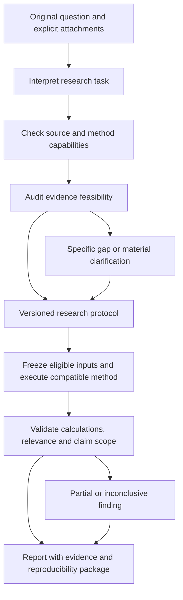

# Architecture and acceptance specification

Companion to [the delivery plan](plan.md) and [research methodology](methodology.md). File names below are proposed boundaries, not existing implemented features unless explicitly identified.

October 21 scope extension: [open sandbox workflow composition](sandbox.md), [historical corpus acquisition](historical-corpus.md), and the [terminal-rs source audit](terminal-rs-reference.md). A later isolated scientific job service can support custom analyses after its validation/isolation gate; fixed trusted calculation engines remain the current execution boundary.

The [October 22 workflow slice](workflow-release.md) implements a bounded descriptive graph over saved observations with durable investigation records, worker execution, Ask tools and original-engine replay. It does not implement all the proposed contracts/methods below.

## Execution flow

The model proposes structured interpretations and plans. Deterministic code validates contracts, source/method compatibility, input versions, time policies, job state and result references. A second model critique can help review reasoning, but cannot override a failed gate or certify statistical validity.

Maintain explicit workflow state: interpreted, assessing, clarification-needed, ready, running, validating, completed, partial, insufficient-evidence, failed or cancelled. Record phase and reason rather than a simulated progress percentage. Track protocol version and optimistic concurrency token; results from an older version cannot appear as current.

## Small modules and dependency rules

Use one responsibility per readable file, targeting 100–250 production lines and a 300-line soft ceiling. Preserve the existing hard limit of 600 in `test/boundaries.test.mjs`. No new large-file exemptions, compressed source, or artificial splits that produce circular dependencies. Declaration files mirror pure shared modules.

| Proposed module | Responsibility | Integration |
| --- | --- | --- |
| `shared/researchIntent.mjs` + declaration | Validate intent/domain/outcome and unresolved fields | Before legacy backtest planning |
| `shared/researchProtocol.mjs` + declaration | Validate/version protocol and material assumptions | Existing research records |
| `shared/researchCompatibility.mjs` + declaration | Task/source/method compatibility and claim ceilings | Planner and dispatch guard |
| `shared/researchEvidence.mjs` + declaration | Evidence/time/identity contracts and eligibility | New and existing adapters |
| `server/ai/researchRouting.mjs` | Resolve interpretation, clarify material ambiguity, legacy handoff | Extract from `run.mjs`, not another giant runner |
| `server/ai/researchCapabilities.mjs` | Typed capability catalog and configured-source status | Tool definitions and feasibility |
| `server/ai/tools/research.mjs` | Thin typed research tools | Existing `tools.mjs` aggregator |
| `server/domain/investigations.mjs` | Investigation/protocol record lifecycle | Existing research SQLite store |
| `server/domain/research-feasibility.mjs` | Coverage/timing/identity/method assessment | Existing domain services |
| `server/domain/research-execution.mjs` | Validated plan-to-job dispatch and durable state | Existing runs, engines and journal |
| `server/domain/research-report.mjs` | Claim ledger, scope assessment and report assembly | Existing citation/grounding/export |
| `server/parsers/policy-events.mjs` | Pure source-to-event normalization | Provider-specific parsers split as needed |
| `server/domain/evidence/policy.mjs` | Acquisition manifests and frozen evidence | Existing evidence storage patterns |
| `src/research/ResearchPlan.tsx` | Interpreted task, material parameters and next action | Research Home and Ask integration |
| `src/research/ResearchFeasibility.tsx` | Source coverage and blocked requirements | Shared investigation view |
| `src/research/ResearchReport.tsx` | Findings, claim support and limitations | Existing research tool shell |
| `src/research/useInvestigation.ts` | Request state, cancellation and version checks | Small integration; no orchestration in `App.tsx` |

Create these files only when their stage needs them. Reuse existing event-study, observation, relationship, experiment, journal and archive services; adapters should not duplicate their calculation or storage logic. Extract groups of tools by domain as `tools.mjs` grows. Keep routes thin and parsers free of I/O.

## Core versioned contracts

Contracts reject unknown material fields and malformed values, retain original inputs, and attach explicit schema versions. Serialize IDs and timestamps predictably. Descriptions are researcher/model commentary, not executable instructions.

**ResearchIntent:** original question; operational interpretation; research family; domains; requested outcome; unit; population; geography; period; explicit attachments; supported interpretation candidates; unresolved material fields; evidence needed for source selection. Do not treat a model's self-reported confidence as calibrated correctness.

**ResearchProtocol:** intent reference/version; hypothesis and alternatives; estimand/outcome; universe and exposure construction; method/version; timing policy; benchmark/comparison; transformations; windows/splits; execution/cost rules where relevant; exclusions; uncertainty and sensitivity plan; intended claim scope; defaults with provenance; planned outputs; parent revision; creation/lock time and content hash.

**Capability:** stable ID and version; task families; source domains; input/output schemas; configured status; historical coverage claims and how verified; pagination/revision behavior; availability precision; compatible methods; quotas; estimated cost class; known gaps. Configuration is not evidence of actual coverage.

**EvidenceRecord:** provider/source-record/version IDs; type; raw payload/document hash and exact span or section/page coordinates; parser version; event/publication/effective/observation/ingestion/update times with timezone, precision and uncertainty bounds; correction lineage; retrieval manifest; provenance basis. Missing values remain null with reasons.

**ExposureMapping:** source/destination entity IDs; relation and rationale; evidence references; valid-time interval; knowledge-time interval; mapping/version and coder/model/prompt provenance; current-only flag; review status; ambiguity. Security IDs distinguish issuer, share class, listing and historical symbol. Do not assume a single timeless ticker per company.

**AnalysisDataset:** immutable ordered event/observation/exposure IDs; price/calendar/identity versions; source and transformation hashes; availability policy; coverage manifest; membership and exclusion ledger. Neutral events do not require buy/sell. Do not inherit transaction-import constraints that require availability after the event: a published rule may announce a future effective date. Validate time relationships by event type. Derived signals reference this dataset and a separate transformation protocol.

**AnalysisResult:** protocol and dataset hashes; engine/runtime/version; seed where relevant; actual parameters; counts and denominators; exclusions; outputs and diagnostics; trial/holdout-use references; status and maximum supported claim scope. Outcomes cannot be promoted beyond source or method capability.

**ResearchClaim:** claim text/type; population/time scope; supporting and contradicting source spans or calculation field paths; entailment/verification status; uncertainty and qualifications; permitted conclusion. Evidence objects are untrusted content and never authorize tool use.

**Investigation:** current protocol version; status; linked tasks, sources, datasets, runs, claims, reports and journal events; parent investigation and timestamps. Keep the existing approved-memory boundary; a new investigation does not grant access to unselected notebook revisions.

## Tool and service boundaries

Expose small typed operations such as `assess_research_capabilities`, `inspect_evidence`, `prepare_research_dataset`, `run_research_analysis` and `inspect_research_result`. Final names may follow existing conventions. They call domain services already used by the UI and share validation. Each returns a structured status, references, provenance and limits; method-specific outputs remain typed rather than a generic JSON blob.

A feasibility tool must distinguish unsupported method, missing configuration, incomplete history, unknown timing, ambiguous identity, failed provider and empty valid sample. The assistant cannot change the study source to bypass those states.

Long retrievals/calculations run as bounded jobs with idempotency keys derived from protocol/input versions, durable checkpoints, explicit cancellation and recorded retries. Cancellation/refresh cannot silently create a second registered experiment. A failed or interrupted job never produces a completed finding. Preserve the existing timeout/call-budget discipline with phase-specific budgets and meaningful partial output.

Calculations run in allowlisted, validated engines; no arbitrary model-generated shell/SQL is exposed to user data. A later scientific worker requires pinned dependencies, typed messages, resource limits and validated outputs. Provider keys stay server-side. Primary-source retrieval is not permission to execute instructions embedded in documents.

## P0 integration details

1. Resolve current intent before prior-run inheritance or `buildSpec`/clarification logic. Simple greetings, sourcing preferences and explicit spec edits retain their fast paths.
2. Allow direct legacy planning only when the task is a compatible signal-strategy request. General legislative/causal/predictive questions get a protocol/capability path. Preserve explicit direct backtest API specs and saved archives.
3. Remove default Congress selection for unresolved general requests. Legislative terms alone cannot authorize personal-trade source selection; mixed questions must retain all requested components.
4. Apply compatibility checks again at tool dispatch, including model source changes in `mergeModelSpec`. A correct planner is insufficient if model tool arguments can reintroduce the wrong source.
5. Change `retryReason`/revision guidance so an appropriate feasibility answer is not rewritten until some unrelated `run_backtest` happens. Review slot/table fallbacks for the same task mismatch.
6. Record interpretation, selected capability, rejected alternatives and reasons. Surface the relevant part in the UI without dumping implementation metadata.
7. Save a bounded local reproduction of the failed task if its execution can be identified; do not infer the exact private conversation from a keyword test.

## User experience and iteration

Show the original question and interpreted task, followed by the proposed design and a concise source assessment. Keep detailed assumptions and evidence inspectable. Important missing timing, weak mappings and incomplete coverage remain visible near conclusions.

Provide a natural next action: run the supported design, resolve a material choice, inspect evidence, or collect a missing dataset. Do not force forms for straightforward questions or ask for repeated approval of routine authorized computation. Running records the protocol/settings used. A material design change creates a revision and labels prior results as belonging to the prior version.

Changing a chart selection can suggest context for the next request; it must not silently replace an ongoing investigation's universe, evidence or conversation. An explicit attach action names the selected chart/events and creates a recorded change.

Reports provide a concise answer first, then design, data, estimates, uncertainty, robustness, counterevidence and reproducibility. Distinguish insufficient evidence, unsupported method and a failed request. These are not interchangeable empty states. Numeric citations are necessary but also check that the study actually addresses the question.

## Acceptance matrix

| Test case | Required outcome |
| --- | --- |
| “Backtest committee markups affecting defense suppliers” | Legislative events/exposure task; no personal-trade fallback; exact data/method gaps if unavailable |
| “Did regulatory changes predict future contract awards?” | Procurement outcome and predictive design; return backtest is not the answer |
| “Did this law cause these firms to outperform?” | Identification assessment; no automatic causal label from CAR |
| “Compare lobbying increases, bill amendments, and later returns” | Multi-domain design preserving each timing policy |
| “Backtest House members' disclosed stock purchases” | Existing explicit Congress strategy works |
| “Backtest insider buys” / explicit saved spec | Correct existing source; historical results replay identically |
| “Now use 30 days” after an explicit stock-disclosure run | Recorded refinement of that strategy |
| New markup question after a congressional portfolio | New task; prior trade source not inherited |
| Generic “backtest this idea” with no usable context | Focused clarification, no assumed source |
| Typo/paraphrase variants and negation | Same intended task or explicit ambiguity; no brittle keyword substitution |
| Current-only entity map or revised-only document | Limitation propagated to eligibility and claim scope |
| Unknown historical availability | Strict tradability blocked; permitted descriptive result labeled |
| After-close, date-only, DST/holiday or effective-before-publication cases | Explicit calendar/precision policy; no guessed instant |
| Amendments, repeated award modifications, negative obligations | Versioned lineage; no duplicate or ceiling-as-obligation inflation |
| No events, failed pages, censored horizon | Separate empty/failed/incomplete states with denominators |
| Overlapping events/small effective sample | Dependence reported; invalid inference suppressed |
| Repeated holdout access, many configurations | Trial and access ledger retained; confirmatory claim restricted |
| Provider/model timeout or cancellation | Partial/failed state, no fabricated result; resume is idempotent |
| Irrelevant but numerically correct model answer | Relevance gate flags it; no completed supported answer |
| Malicious source text/model tool arguments | No instruction or access escalation; source/protocol guards hold |

## Verification and release evidence

- Pure contract/routing tests cover all deterministic acceptance cases. Build a fixed intent corpus with positive, negative, ambiguous, mixed, typo and follow-up examples; expand it with real failures. Zero known silent task substitutions are acceptable in the release corpus.
- Statistical engine tests compare hand-worked examples, published/author replication fixtures where permitted, and independent reference implementations. Include null, confounded, anticipatory, overlapping and deliberately leaking synthetic datasets. Validate results and failures, not method names alone.
- Temporal integration tests cover document corrections, publication bounds, relationship history, historical universe membership, session entry and incomplete outcomes. Hashes must identify every actual input version.
- End-to-end API tests prove protocol→data→run→report lineage, idempotency, errors, cancellation, migration, restart, rollback and replay. Assert that an incompatible tool is never executed, even if a model requests it.
- Browser verification covers plan editing, relevant clarification, partial/insufficient states, source inspection, report/export, research/chart handoff and mobile/keyboard use. Use isolated synthetic records for destructive or recovery tests.
- Frozen-model regression tests measure task fidelity, supported-claim precision, citation entailment, appropriate abstention and tool choice. Track latency/cost and model/prompt version. LLM self-review is not the sole acceptance judge; review a fixed sample independently.
- Source acceptance uses bounded real-provider corpora with manually reconciled records. Synthetic success does not establish real historical coverage. Pilot results must disclose exact evaluated source/date limits.
- Run repository boundary checks, focused tests, full tests and production build for runtime changes. The current test harness can be timing-sensitive under concurrent load; record the invocation and results instead of relaxing scientific or startup assertions to hide failures.

A release packet contains changes, schema migrations, known capability limits, regression results, numerical validation, browser evidence, sample source audit, reproducibility/recovery evidence and unresolved issues. Scorecards show separate dimensions; do not display one academic-quality number.

## Migration and first pull-request boundaries

1. **Routing correction:** shared intent/compatibility contracts, extracted routing adapter, legacy/dispatch/retry guards, regression corpus and minimal UI indication.
2. **Investigation protocol:** additive tables/records in the existing research store, capability assessment, journal integration and plan/feasibility view.
3. **Policy evidence pilot:** source-specific acquisition/parsers, evidence manifests, temporal identities and reviewed exposure mappings.
4. **Neutral event analysis:** versioned event adapter into the validated existing engine; old engine archives remain unchanged and replayable.
5. **Integrated investigation:** assistant tools, report claims, chart/notebook links and archive extensions.
6. **Additional methods:** individually reviewed estimator/validation packages, each with capability status and explicit applicability boundaries.

No wholesale rewrite is required. Additive schema changes preserve older experiments and exports; any changed calculation receives a new engine version. A deployment flag controls new routing, but turning it off must not re-enable silent substitution for queries already recognized as incompatible. Rollback reports an unavailable general-research path while preserving direct valid legacy analyses.
